

  <picture>
    <source media="(max-width: 600px)" srcset="assets/mobile/header.svg">
    
  </picture>

  <picture>
    <source media="(max-width: 600px)" srcset="assets/mobile/break.svg">
    
  </picture>

## About

  <picture>
    <source media="(max-width: 600px)" srcset="assets/mobile/about.svg">
    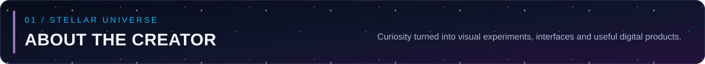
  </picture>

  

Hello! I'm **Lucky Praditya** — a visual designer and creator exploring the intersection of design, technology, and AI.

I enjoy turning ideas into visual identities, interfaces, and digital products. My workflow moves between creative direction, UI/UX exploration, frontend development, and AI-assisted building. I care about both how something works and how it feels to use.

### Currently exploring

- Visual design, illustration, and digital brand experiences.
- Frontend development and product interface implementation.
- AI-assisted workflows, rapid prototyping, and creative engineering.
- Building independent digital products from concept to iteration.

### A few principles

- Make it clear before making it complex.
- Preserve the idea while improving the experience.
- Build thoughtfully, test honestly, and keep learning.

---

## Journey

  <picture>
    <source media="(max-width: 600px)" srcset="assets/mobile/journey.svg">
    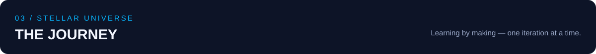
  </picture>

  <picture>
    <source media="(max-width: 600px)" srcset="assets/mobile/timeline.svg">
    
  </picture>

---

## Selected Projects

  <picture>
    <source media="(max-width: 600px)" srcset="assets/mobile/projects.svg">
    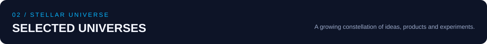
  </picture>

| Project | Description |
|---|---|
|  | **STELLAR UNIVERSE** — Personal brand, portfolio, and creative engineering. |
|  | **LUMORA** — Personal Life Operating System. |
|  | **NUVIO FINANCE** — Personal Finance OS. |
|  | **AFTER** — Personal Life Archive for memories and moments. |
|  | **RIDELINK** — Smart Riding Ecosystem. |
|  | **VISORA** — Optical Management System. |
|  | **SAFaa** — Muslim Companion. |

  These projects are at different stages of exploration and development. Dedicated repository and product links will be added when their public destinations are ready.

---

## Technology Stack

  <picture>
    <source media="(max-width: 600px)" srcset="assets/mobile/stack.svg">
    
  </picture>

  <picture>
    <source media="(max-width: 600px)" srcset="assets/mobile/tech-stack-matrix.svg">
    
  </picture>

  <picture>
    <source media="(max-width: 600px)" srcset="assets/mobile/marquee.svg">
    
  </picture>

---

## AI Toolbox & Workflow

  <picture>
    <source media="(max-width: 600px)" srcset="assets/section-panels/mobile/ai.svg">
    
  </picture>

  <picture>
    <source media="(max-width: 600px)" srcset="assets/mobile/ai-toolbox.svg">
    
  </picture>

  <picture>
    <source media="(max-width: 600px)" srcset="assets/mobile/ai-orbit.svg">
    
  </picture>

**Explore · Prototype · Refine · Ship**

My current AI-assisted workflow includes:

- **ChatGPT** — product thinking, requirements, prompt writing, architecture exploration, and problem-solving.
- **Google Gemini** — visual research, reference analysis, creative exploration, and image-based ideation.
- **Google Stitch** — AI-assisted UI/UX exploration, screen generation, and visual references for implementation.
- **Replit Agent** — implementation support, feature iteration, and debugging inside Replit.

---

## GitHub Activity

  <picture>
    <source media="(max-width: 600px)" srcset="assets/mobile/stats.svg">
    
  </picture>

  

  
  

  

  

---

## Contribution Arcade

  <picture>
    <source media="(max-width: 600px)" srcset="assets/mobile/arcade.svg">
    
  </picture>
<picture>
    <source media="(prefers-color-scheme: dark)" srcset="https://raw.githubusercontent.com/LucAetheryn/LucAetheryn/output/github-snake-dark.svg">
    <source media="(prefers-color-scheme: light)" srcset="https://raw.githubusercontent.com/LucAetheryn/LucAetheryn/output/github-snake.svg">
    
  </picture>
  

  

---

## Guestbook

  <picture>
    <source media="(max-width: 600px)" srcset="assets/mobile/guestbook.svg">
    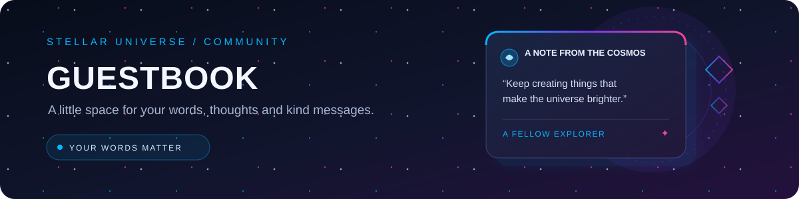
  </picture>

Have a thought, suggestion, or just want to say hello?

Leave a message in the [GitHub Guestbook](https://github.com/LucAetheryn/LucAetheryn/issues).

---

## Connect

  <picture>
    <source media="(max-width: 600px)" srcset="assets/section-panels/social-cards/socials-header.svg">
    
  </picture>

  <a href="https://github.com/LucAetheryn"><picture>
    <source media="(min-width: 601px)" srcset="assets/section-panels/social-cards/social-github-desktop.svg" width="200" height="80">
    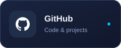
  </picture></a>
  <a href="https://www.instagram.com/lucky.praditya?gwpx=MWNvMGJwOThnMnVuZg=="><picture>
    <source media="(min-width: 601px)" srcset="assets/section-panels/social-cards/social-instagram-desktop.svg" width="200" height="80">
    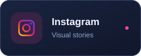
  </picture></a>
  <a href="https://www.tiktok.com/@lucky.pradityaaa?_r=1&amp;_t=ZS-9BVtaE8LNT7"><picture>
    <source media="(min-width: 601px)" srcset="assets/section-panels/social-cards/social-tiktok-desktop.svg" width="200" height="80">
    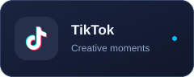
  </picture></a>
  <a href="https://www.linkedin.com/in/luckypraditya/"><picture>
    <source media="(min-width: 601px)" srcset="assets/section-panels/social-cards/social-linkedin-desktop.svg" width="200" height="80">
    
  </picture></a>

  <picture>
    <source media="(max-width: 600px)" srcset="assets/mobile/break.svg">
    
  </picture>

  

  *Designing ideas · Building experiences · Exploring what’s next*

