

  <picture>
    <source media="(max-width: 600px)" srcset="assets/mobile/header.svg">
    
  </picture>"GitHub" (https://github.com/LucAetheryn) ·
"LinkedIn" (https://www.linkedin.com/in/luckypraditya/) ·
"Instagram" (https://www.instagram.com/lucky.praditya?gwpx=MWNvMGJwOThnMnVuZg==) ·
"TikTok" (https://www.tiktok.com/@lucky.pradityaaa?_r=1&_t=ZS-9BVtaE8LNT7)

---

  <picture>
    <source media="(max-width: 600px)" srcset="assets/mobile/break.svg">
    
  </picture>

About

Hello! I'm Lucky Praditya — a visual designer and creator exploring the intersection of design, technology, and AI.

I enjoy turning ideas into visual identities, interfaces, and digital products. My workflow moves between creative direction, UI/UX exploration, frontend development, and AI-assisted building. I care about both how something works and how it feels to use.

Currently Exploring

- Visual design, illustration, and digital brand experiences.
- Frontend development and product interface implementation.
- AI-assisted workflows, rapid prototyping, and creative engineering.
- Building independent digital products from concept to iteration.

A Few Principles

- Make it clear before making it complex.
- Preserve the idea while improving the experience.
- Build thoughtfully, test honestly, and keep learning.

  <picture>
    <source media="(max-width: 600px)" srcset="assets/mobile/about.svg">
    
  </picture>  <picture>
    <source media="(max-width: 600px)" srcset="assets/section-panels/mobile/about.svg">
    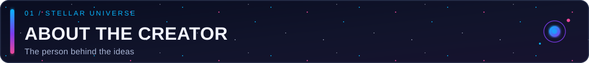
  </picture>  

---

Journey

  <picture>
    <source media="(max-width: 600px)" srcset="assets/mobile/journey.svg">
    
  </picture>  <picture>
    <source media="(max-width: 600px)" srcset="assets/section-panels/mobile/journey.svg">
    
  </picture>  <picture>
    <source media="(max-width: 600px)" srcset="assets/mobile/timeline.svg">
    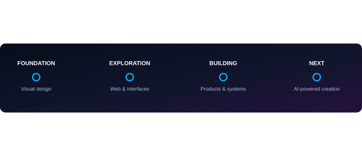
  </picture>

Foundation| Exploration| Building| Next
Visual Design| Web & Interfaces| Products & Systems| AI-powered Creation

---

Selected Projects

  <picture>
    <source media="(max-width: 600px)" srcset="assets/mobile/projects.svg">
    
  </picture>  <picture>
    <source media="(max-width: 600px)" srcset="assets/section-panels/mobile/projects.svg">
    
  </picture>

Project| Description
| STELLAR UNIVERSE — Personal brand, portfolio, and creative engineering.
| LUMORA — Personal Life Operating System.
| NUVIO FINANCE — Personal Finance OS.
| AFTER — Personal Life Archive for memories and moments.
| RIDELINK — Smart Riding Ecosystem.
| VISORA — Optical Management System.
| SAFaa — Muslim Companion.

  These projects are at different stages of exploration and development. Dedicated repository and product links will be added when their public destinations are ready.

---

Technology Stack

  <picture>
    <source media="(max-width: 600px)" srcset="assets/mobile/stack.svg">
    
  </picture>

  <strong>Programming Languages</strong>

  
  
  
  
  
  

  <strong>Frameworks & Libraries</strong>

  
  

  <strong>Backend, Database & Authentication</strong>

  
  
  
  
  

  <strong>Storage & Media</strong>

  
  

  <strong>Design & Product</strong>

  
  
  
  

  <strong>Development & Deployment</strong>

  
  
  
  
  
  

  <picture>
    <source media="(max-width: 600px)" srcset="assets/mobile/tech-stack-matrix.svg">
    
  </picture>

The list above reflects tools and platforms used or explored across my projects. It represents my working toolkit, not a claim of equal expertise in every technology.

  <picture>
    <source media="(max-width: 600px)" srcset="assets/mobile/marquee.svg">
    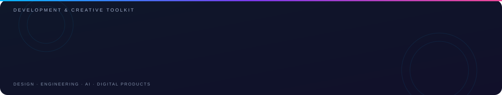
  </picture>

---

AI Toolbox & Workflow

  <picture>
    <source media="(max-width: 600px)" srcset="assets/mobile/ai.svg">
    
  </picture>  <picture>
    <source media="(max-width: 600px)" srcset="assets/section-panels/mobile/ai.svg">
    
  </picture>  <picture>
    <source media="(max-width: 600px)" srcset="assets/mobile/ai-orbit.svg">
    
  </picture>

  <picture>
    <source media="(max-width: 600px)" srcset="assets/mobile/ai-toolbox.png">
    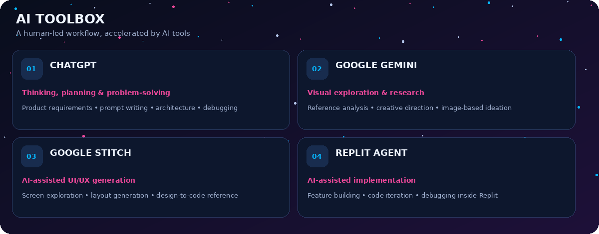
  </picture>

  
  
  
  

Explore · Prototype · Refine · Ship

My current AI-assisted workflow includes:

- ChatGPT — product thinking, requirements, prompt writing, architecture exploration, and problem-solving.
- Google Gemini — visual research, reference analysis, creative exploration, and image-based ideation.
- Google Stitch — AI-assisted UI/UX exploration, screen generation, and visual references for implementation.
- Replit Agent — implementation support, feature iteration, and debugging inside Replit.

---

GitHub Activity

  <picture>
    <source media="(max-width: 600px)" srcset="assets/mobile/stats.svg">
    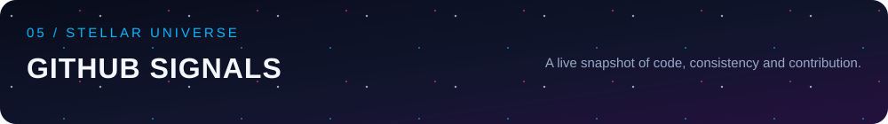
  </picture>  <picture>
    <source media="(max-width: 600px)" srcset="assets/section-panels/mobile/stats.svg">
    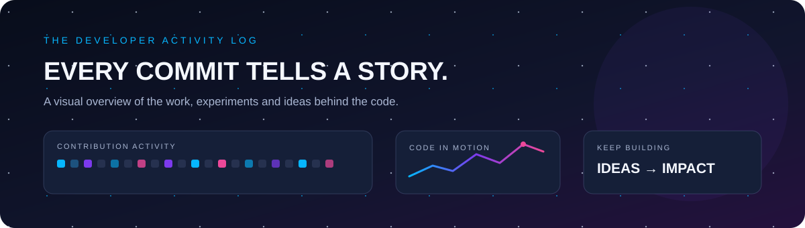
  </picture>

    
    
  

  <picture>
    <source media="(prefers-color-scheme: dark)" srcset="https://raw.githubusercontent.com/LucAetheryn/LucAetheryn/output/github-snake-dark.svg">
    <source media="(prefers-color-scheme: light)" srcset="https://raw.githubusercontent.com/LucAetheryn/LucAetheryn/output/github-snake.svg">
    
  </picture>

---

Contribution Arcade

  <picture>
    <source media="(max-width: 600px)" srcset="assets/mobile/arcade.svg">
    
  </picture>  <picture>
    <source media="(max-width: 600px)" srcset="assets/section-panels/mobile/arcade.svg">
    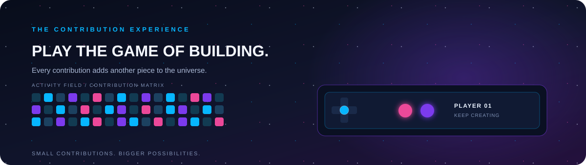
  </picture>    

---

Guestbook

  <picture>
    <source media="(max-width: 600px)" srcset="assets/mobile/guestbook.svg">
    
  </picture>  <picture>
    <source media="(max-width: 600px)" srcset="assets/section-panels/mobile/guestbook.svg">
    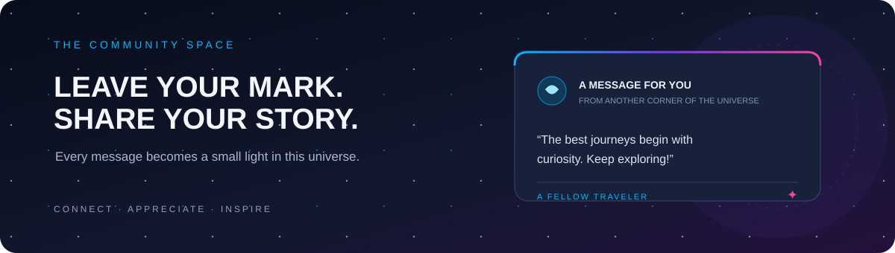
  </picture>

Have a thought, suggestion, or just want to say hello?

Leave a message in the "GitHub Guestbook" (https://github.com/LucAetheryn/LucAetheryn/issues).

---

Connect

  <picture>
    <source media="(max-width: 600px)" srcset="assets/section-panels/mobile/socials.svg">
    
  </picture>"GitHub" (https://github.com/LucAetheryn) ·
"Instagram" (https://www.instagram.com/lucky.praditya?gwpx=MWNvMGJwOThnMnVuZg==) ·
"TikTok" (https://www.tiktok.com/@lucky.pradityaaa?_r=1&_t=ZS-9BVtaE8LNT7) ·
"LinkedIn" (https://www.linkedin.com/in/luckypraditya/)

  <picture>
    <source media="(max-width: 600px)" srcset="assets/mobile/break.svg">
    
  </picture>  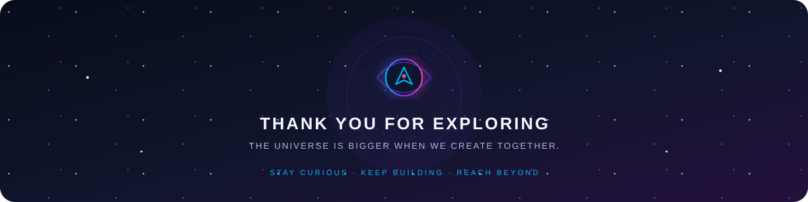Designing ideas · Building experiences · Exploring what’s next

