<div align="center">
  <picture>
    <source media="(max-width: 768px)" srcset="https://raw.githubusercontent.com/LucAetheryn/LucAetheryn/main/assets/mobile/header.svg">
    
  </picture>
</div>

<div align="center">

[](https://github.com/LucAetheryn)
[](https://github.com/LucAetheryn)

**Visual Designer & Illustrator · Visual & AI Engineer Enthusiast**

*Designing ideas. Building experiences. Exploring what’s next.*

</div>

<picture>
  <source media="(max-width: 768px)" srcset="https://raw.githubusercontent.com/LucAetheryn/LucAetheryn/main/assets/section-panels/mobile/about.png">
  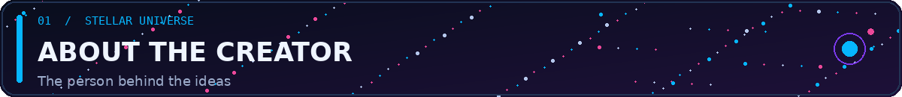
</picture>

<div align="center">
  
</div>

Hello! I'm **Lucky Praditya** — a visual designer and creator exploring the intersection of design, technology, and AI.

I enjoy turning ideas into visual identities, interfaces, and digital products. My workflow moves between creative direction, UI/UX exploration, frontend development, and AI-assisted building. I care about both how something works and how it feels to use.

**Currently exploring**
- Visual design, illustration, and digital brand experiences.
- Frontend development and product interface implementation.
- AI-assisted workflows, rapid prototyping, and creative engineering.
- Building independent digital products from concept to iteration.

**A few principles**
- Make it clear before making it complex.
- Preserve the idea while improving the experience.
- Build thoughtfully, test honestly, and keep learning.

<picture>
  <source media="(max-width: 768px)" srcset="https://raw.githubusercontent.com/LucAetheryn/LucAetheryn/main/assets/section-panels/mobile/journey.png">
  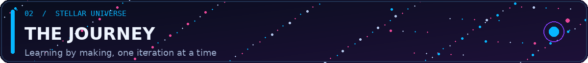
</picture>
<picture>
  <source media="(max-width: 768px)" srcset="https://raw.githubusercontent.com/LucAetheryn/LucAetheryn/main/assets/mobile/timeline.svg">
  
</picture>

<picture>
  <source media="(max-width: 768px)" srcset="https://raw.githubusercontent.com/LucAetheryn/LucAetheryn/main/assets/section-panels/mobile/projects.png">
  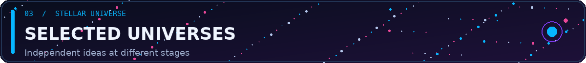
</picture>

<div align="center">
  <a href="https://github.com/LucAetheryn"></a>
  <a href="https://github.com/LucAetheryn"></a>
  <a href="https://github.com/LucAetheryn"></a>
  <a href="https://github.com/LucAetheryn"></a>
  <a href="https://github.com/LucAetheryn">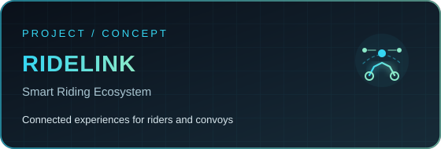</a>
  <a href="https://github.com/LucAetheryn"></a>
  <a href="https://github.com/LucAetheryn"></a>
</div>

<div align="center">
  <sub>These projects are at different stages of exploration and development. Dedicated repository and product links will be added when their public destinations are ready.</sub>
</div>

<picture>
  <source media="(max-width: 768px)" srcset="https://raw.githubusercontent.com/LucAetheryn/LucAetheryn/main/assets/section-panels/mobile/stack.png">
  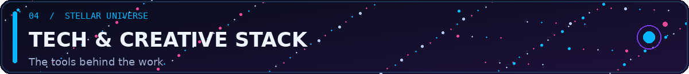
</picture>

<picture>
  <source media="(max-width: 768px)" srcset="https://raw.githubusercontent.com/LucAetheryn/LucAetheryn/main/assets/mobile/tech-stack-matrix.png">
  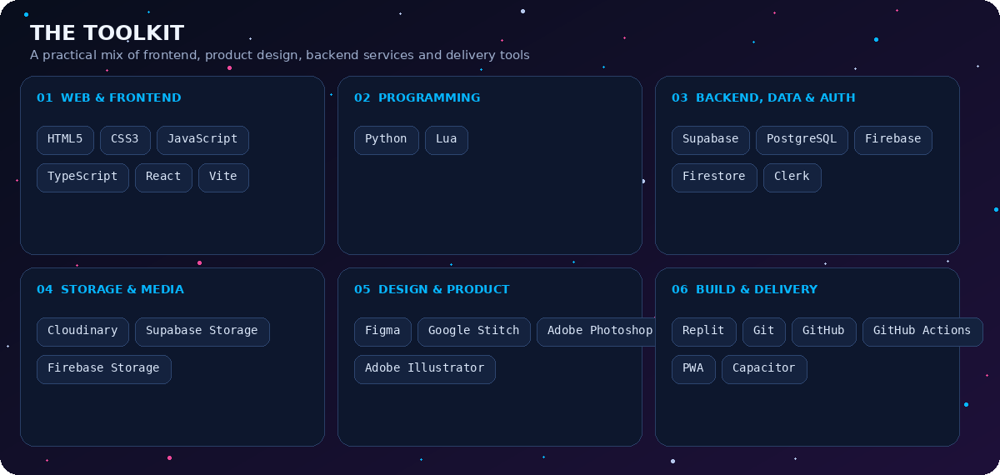
</picture>

The list below reflects tools and platforms used or explored across my projects. It represents my working toolkit, not a claim of equal expertise in every technology.

**Web & Frontend**  
`HTML5` · `CSS3` · `JavaScript` · `TypeScript` · `React` · `Vite`

**Programming & Scripting**  
`Python` · `Lua`

**Backend, Data & Authentication**  
`Supabase` · `PostgreSQL` · `Firebase` · `Firestore` · `Clerk`

**Storage & Media**  
`Cloudinary` · `Supabase Storage`

**Design & Product**  
`Figma` · `Google Stitch` · `Adobe Photoshop` · `Adobe Illustrator`

**Build, Version Control & Delivery**  
`Replit` · `Git` · `GitHub` · `GitHub Actions` · `Progressive Web Apps (PWA)` · `Capacitor`

<picture>
  <source media="(max-width: 768px)" srcset="https://raw.githubusercontent.com/LucAetheryn/LucAetheryn/main/assets/section-panels/mobile/ai.png">
  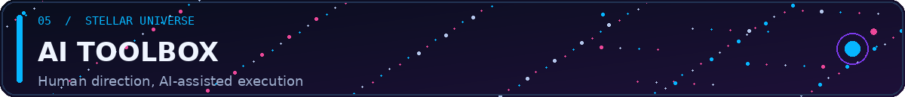
</picture>

<picture>
  <source media="(max-width: 768px)" srcset="https://raw.githubusercontent.com/LucAetheryn/LucAetheryn/main/assets/mobile/ai-orbit.svg">
  
</picture>

<picture>
  <source media="(max-width: 768px)" srcset="https://raw.githubusercontent.com/LucAetheryn/LucAetheryn/main/assets/mobile/ai-toolbox.png">
  
</picture>

My current AI-assisted workflow includes:

- **ChatGPT** — product thinking, requirements, prompt writing, architecture exploration, and problem-solving.
- **Google Gemini** — visual research, reference analysis, creative exploration, and image-based ideation.
- **Google Stitch** — AI-assisted UI/UX exploration, screen generation, and visual references for implementation.
- **Replit Agent** — implementation support, feature iteration, and debugging inside Replit.

AI helps accelerate the process; product direction, design decisions, implementation review, and quality checks remain human-led.

<picture>
  <source media="(max-width: 768px)" srcset="https://raw.githubusercontent.com/LucAetheryn/LucAetheryn/main/assets/section-panels/mobile/stats.png">
  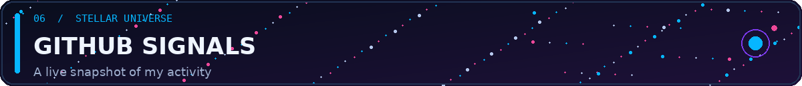
</picture>

<div align="center">
  
  
  
</div>

<div align="center">
  <sub>Expanded profile summary cards are generated by GitHub Actions. After the first successful run, their optional embed snippet is available in <code>README-AFTER-ACTIONS.md</code>.</sub>
</div>

<picture>
  <source media="(max-width: 768px)" srcset="https://raw.githubusercontent.com/LucAetheryn/LucAetheryn/main/assets/section-panels/mobile/arcade.png">
  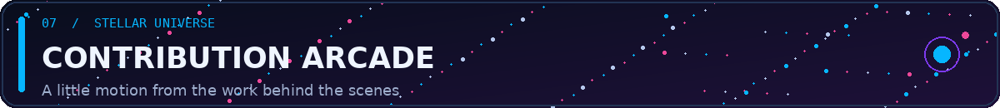
</picture>

<div align="center">
  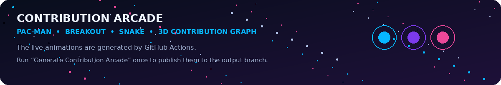
</div>

<p align="center">
  <sub>Run the <b>Generate Contribution Arcade</b> workflow once to publish the live Snake, Pac-Man, Breakout, and 3D contribution visuals to the <code>output</code> branch. The dynamic embed snippet is included in <code>README-AFTER-ACTIONS.md</code>.</sub>
</p>

<picture>
  <source media="(max-width: 768px)" srcset="https://raw.githubusercontent.com/LucAetheryn/LucAetheryn/main/assets/section-panels/mobile/guestbook.png">
  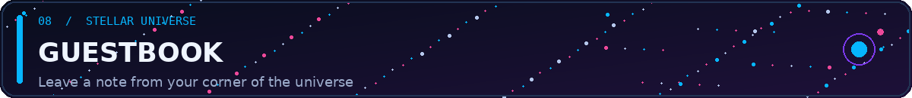
</picture>

<div align="center">
  <a href="https://github.com/LucAetheryn/LucAetheryn/issues/new?template=guestbook.yml">
    
  </a>
  <br>
  <sub>Guestbook messages are checked and listed from labelled GitHub Issues.</sub>
</div>

<!-- GUESTBOOK:START -->
<p align="center"><i>No entries yet. Be the first to sign ✦</i></p>
<!-- GUESTBOOK:END -->

<picture>
  <source media="(max-width: 768px)" srcset="https://raw.githubusercontent.com/LucAetheryn/LucAetheryn/main/assets/section-panels/mobile/break.png">
  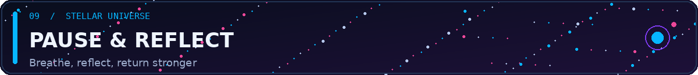
</picture>

<div align="center">
  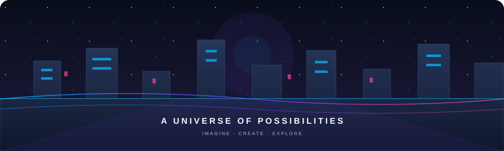
  <br><br>
  **Thanks for visiting. See you among the stars.** ✦
  <br>
  <sub>Made with curiosity, creativity, and a little cosmic energy.</sub>
</div>


<details>
  <summary>✦ A small easter egg</summary>
  <br>
  ```console
  > keep exploring
  > keep creating
  > repeat
  ```
</details>
