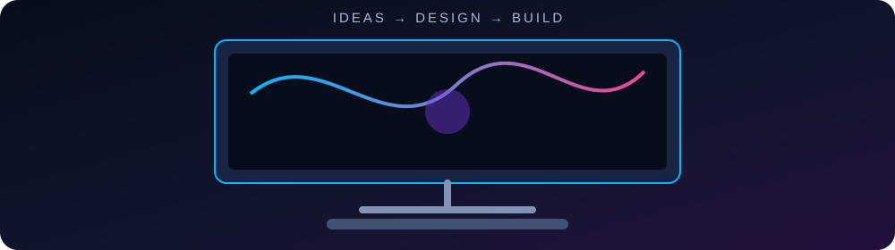
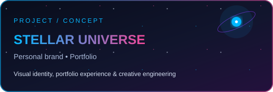
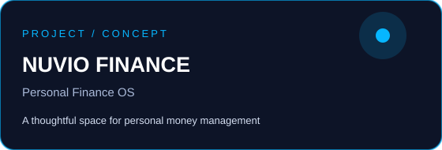
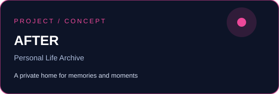
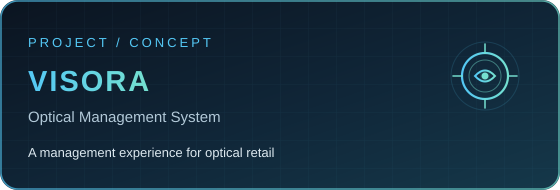

  <picture>
    <source media="(max-width: 768px)" srcset="https://raw.githubusercontent.com/LucAetheryn/LucAetheryn/main/assets/mobile/header.svg">
    
  </picture>

**Visual Designer & Illustrator · Visual & AI Engineer Enthusiast**

*Designing ideas. Building experiences. Exploring what’s next.*

<picture>
  <source media="(max-width: 768px)" srcset="https://raw.githubusercontent.com/LucAetheryn/LucAetheryn/main/assets/mobile/about.svg">
  
</picture>

  

Hello! I'm **Lucky Praditya** — a visual designer and creator exploring the intersection of design, technology, and AI.

I enjoy turning ideas into visual identities, interfaces, and digital products. My workflow moves between creative direction, UI/UX exploration, frontend development, and AI-assisted building. I care about both how something works and how it feels to use.

**Currently exploring**
- Visual design, illustration, and digital brand experiences.
- Frontend development and product interface implementation.
- AI-assisted workflows, rapid prototyping, and creative engineering.
- Building independent digital products from concept to iteration.

**A few principles**
- Make it clear before making it complex.
- Preserve the idea while improving the experience.
- Build thoughtfully, test honestly, and keep learning.

<picture>
  <source media="(max-width: 768px)" srcset="https://raw.githubusercontent.com/LucAetheryn/LucAetheryn/main/assets/mobile/journey.svg">
  
</picture>
<picture>
  <source media="(max-width: 768px)" srcset="https://raw.githubusercontent.com/LucAetheryn/LucAetheryn/main/assets/mobile/timeline.svg">
  
</picture>

<picture>
  <source media="(max-width: 768px)" srcset="https://raw.githubusercontent.com/LucAetheryn/LucAetheryn/main/assets/mobile/projects.svg">
  
</picture>

  
  
  
  
  
  
  

  These are projects and product concepts at different stages of exploration and development. Project cards will be linked to their dedicated repositories or live products when those URLs are ready.

<picture>
  <source media="(max-width: 768px)" srcset="https://raw.githubusercontent.com/LucAetheryn/LucAetheryn/main/assets/mobile/stack.svg">
  
</picture>
<picture>
  <source media="(max-width: 768px)" srcset="https://raw.githubusercontent.com/LucAetheryn/LucAetheryn/main/assets/mobile/marquee.svg">
  
</picture>

**Development**  
`HTML` · `CSS` · `JavaScript` · `TypeScript` · `React` · `Vite` · `Python` · `Lua`

**Backend & platforms**  
`Supabase` · `Firebase` · `Cloudinary` · `Git` · `GitHub` · `Replit`

**Design & creative**  
`Figma` · `Adobe Photoshop` · `Adobe Illustrator` · `Google Stitch`

<picture>
  <source media="(max-width: 768px)" srcset="https://raw.githubusercontent.com/LucAetheryn/LucAetheryn/main/assets/mobile/ai.svg">
  
</picture>
<picture>
  <source media="(max-width: 768px)" srcset="https://raw.githubusercontent.com/LucAetheryn/LucAetheryn/main/assets/mobile/ai-orbit.svg">
  
</picture>

I use AI as a creative and development accelerator — for research, ideation, prototyping, debugging, and iteration. The direction, decisions, and quality checks remain human-led.

<picture>
  <source media="(max-width: 768px)" srcset="https://raw.githubusercontent.com/LucAetheryn/LucAetheryn/main/assets/mobile/stats.svg">
  
</picture>

  
  
  

<picture>
  <source media="(max-width: 768px)" srcset="https://raw.githubusercontent.com/LucAetheryn/LucAetheryn/main/assets/mobile/arcade.svg">
  
</picture>

**Contribution Snake**

<picture>
  <source media="(prefers-color-scheme: dark)" srcset="https://raw.githubusercontent.com/LucAetheryn/LucAetheryn/output/github-contribution-grid-snake-dark.svg">
  <source media="(prefers-color-scheme: light)" srcset="https://raw.githubusercontent.com/LucAetheryn/LucAetheryn/output/github-contribution-grid-snake.svg">
  
</picture>

<picture>
  <source media="(max-width: 768px)" srcset="https://raw.githubusercontent.com/LucAetheryn/LucAetheryn/main/assets/mobile/guestbook.svg">
  
</picture>

  
   
  Guestbook messages are published after GitHub Actions validates the submitted issue.

<!-- GUESTBOOK:START -->
| Visitor | Message | Date |
|:--|:--|:--:|
| *Your message could be the first one here.* | Welcome to this little corner of the universe. | ✦ |
<!-- GUESTBOOK:END -->

<picture>
  <source media="(max-width: 768px)" srcset="https://raw.githubusercontent.com/LucAetheryn/LucAetheryn/main/assets/mobile/break.svg">
  
</picture>

  
    
  **Thanks for visiting. See you among the stars.** ✦
   
  Made with curiosity, creativity, and a little cosmic energy.

  
✦ A small easter egg

   
  `> keep exploring`  
  `> keep creating`  
  `> repeat`

