
  
  <picture>  
    <source media="(max-width: 600px)" srcset="assets/mobile/header.svg">  
      
  </picture>  Visual Designer & Illustrator · Visual & AI Engineer Enthusiast

Designing ideas. Building experiences. Exploring what’s next.

GitHub ·
LinkedIn ·
Instagram ·
TikTok

  
---

  
  <picture>  
    <source media="(max-width: 600px)" srcset="assets/mobile/break.svg">  
      
  </picture>  

  About

Hello! I'm Lucky Praditya — a visual designer and creator exploring the intersection of design, technology, and AI.

I enjoy turning ideas into visual identities, interfaces, and digital products. My workflow moves between creative direction, UI/UX exploration, frontend development, and AI-assisted building. I care about both how something works and how it feels to use.

Currently exploring

- Visual design, illustration, and digital brand experiences.
- Frontend development and product interface implementation.
- AI-assisted workflows, rapid prototyping, and creative engineering.
- Building independent digital products from concept to iteration.

A few principles

- Make it clear before making it complex.
- Preserve the idea while improving the experience.
- Build thoughtfully, test honestly, and keep learning.

  
  <picture>  
    <source media="(max-width: 600px)" srcset="assets/mobile/about.svg">  
      
  </picture>  
  <picture>  
    <source media="(max-width: 600px)" srcset="assets/section-panels/mobile/about.svg">  
      
  </picture>  
    

  
---

Journey

  
  <picture>  
    <source media="(max-width: 600px)" srcset="assets/mobile/journey.svg">  
      
  </picture>  
  <picture>  
    <source media="(max-width: 600px)" srcset="assets/section-panels/mobile/journey.svg">  
    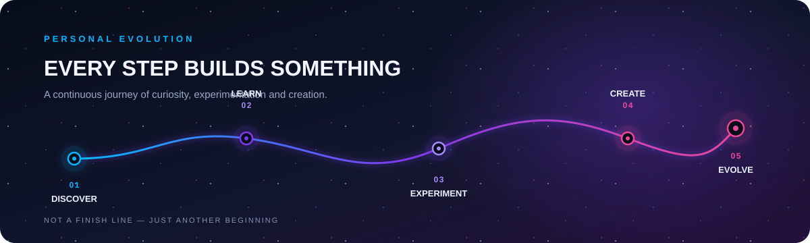  
  </picture>  
  <picture>  
    <source media="(max-width: 600px)" srcset="assets/mobile/timeline.svg">  
      
  </picture>  

  Foundation	Exploration	Building	Next

Visual design	Web & interfaces	Products & systems	AI-powered creation

---

Selected Projects

  
  <picture>  
    <source media="(max-width: 600px)" srcset="assets/mobile/projects.svg">  
      
  </picture>  
  <picture>  
    <source media="(max-width: 600px)" srcset="assets/section-panels/mobile/projects.svg">  
    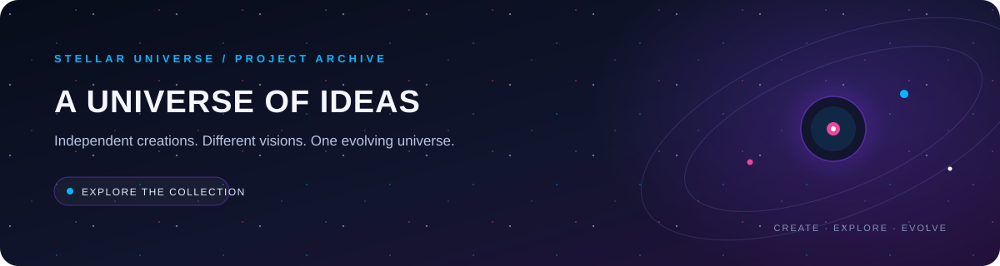  
  </picture>  

  
  Project	Description

	STELLAR UNIVERSE — Personal brand, portfolio, and creative engineering.
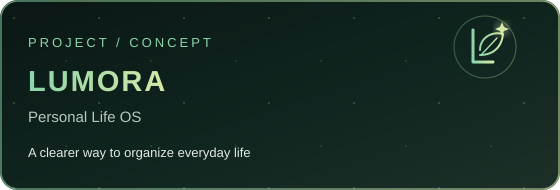	LUMORA — Personal Life Operating System.
	NUVIO FINANCE — Personal Finance OS.
	AFTER — Personal Life Archive for memories and moments.
	RIDELINK — Smart Riding Ecosystem.
	VISORA — Optical Management System.
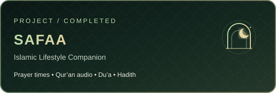	SAFaa — Muslim Companion.

  
  
  These projects are at different stages of exploration and development. Dedicated repository and product links will be added when their public destinations are ready.  

  
---

Technology Stack

  
  <picture>  
    <source media="(max-width: 600px)" srcset="assets/mobile/stack.svg">  
    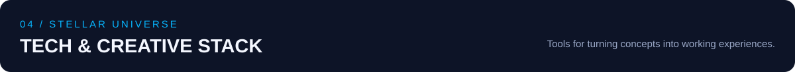  
  </picture>  
  <picture>  
    <source media="(max-width: 600px)" srcset="assets/mobile/tech-stack-matrix.svg">  
    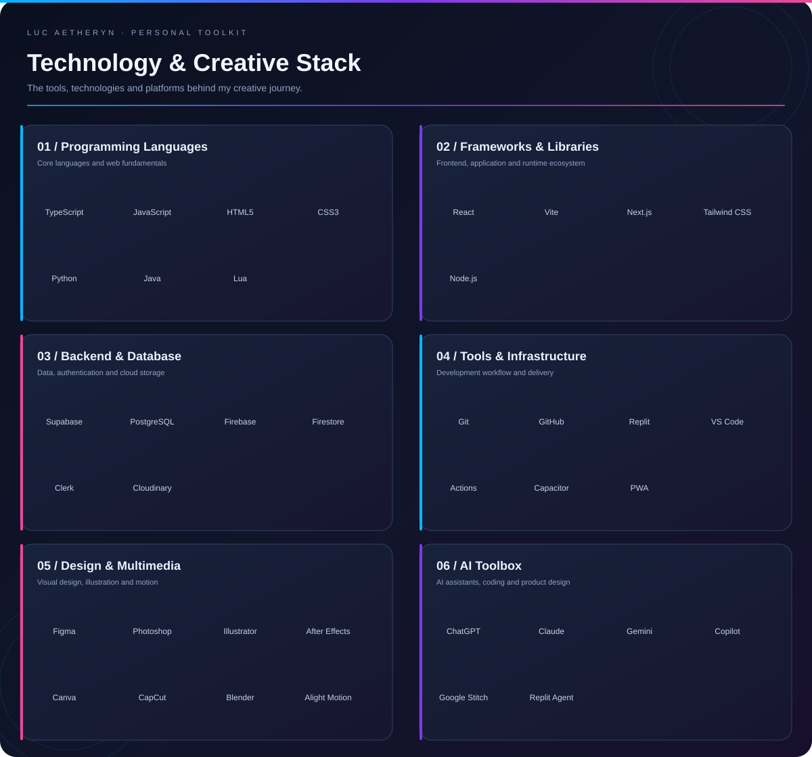  
  </picture>  

  The list below reflects tools and platforms used or explored across my projects. It represents my working toolkit, not a claim of equal expertise in every technology.

Category	Technologies & Tools

Web & Frontend	HTML5 · CSS3 · JavaScript · TypeScript · React · Vite
Programming & Scripting	Python · Lua
Backend, Data & Authentication	Supabase · PostgreSQL · Firebase · Firestore · Clerk
Storage & Media	Cloudinary · Supabase Storage
Design & Product	Figma · Google Stitch · Adobe Photoshop · Adobe Illustrator
Build, Version Control & Delivery	Replit · Git · GitHub · GitHub Actions · PWA · Capacitor

  
  <picture>  
    <source media="(max-width: 600px)" srcset="assets/mobile/marquee.svg">  
      
  </picture>  

  
---

AI Toolbox & Workflow

  
  <picture>  
    <source media="(max-width: 600px)" srcset="assets/mobile/ai.svg">  
    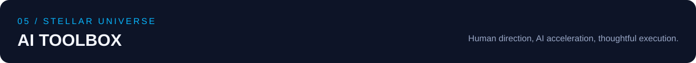  
  </picture>  
  <picture>  
    <source media="(max-width: 600px)" srcset="assets/section-panels/mobile/ai.svg">  
    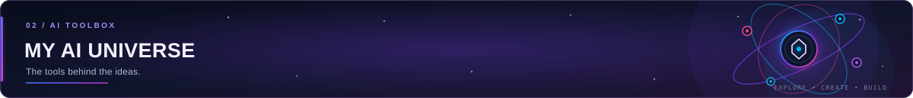  
  </picture>  
  <picture>  
    <source media="(max-width: 600px)" srcset="assets/mobile/ai-orbit.svg">  
    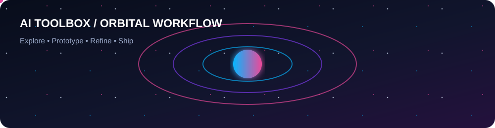  
  </picture>  
  <picture>  
    <source media="(max-width: 600px)" srcset="assets/mobile/ai-toolbox.svg">  
    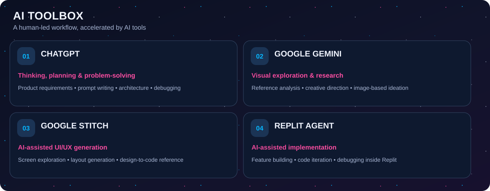  
  </picture>  

  Explore · Prototype · Refine · Ship

My current AI-assisted workflow includes:

- ChatGPT — product thinking, requirements, prompt writing, architecture exploration, and problem-solving.
- Google Gemini — visual research, reference analysis, creative exploration, and image-based ideation.
- Google Stitch — AI-assisted UI/UX exploration, screen generation, and visual references for implementation.
- Replit Agent — implementation support, feature iteration, and debugging inside Replit.

---

GitHub Activity

  
  <picture>  
    <source media="(max-width: 600px)" srcset="assets/mobile/stats.svg">  
      
  </picture>  
  <picture>  
    <source media="(max-width: 600px)" srcset="assets/section-panels/mobile/stats.svg">  
      
  </picture>  

  
  
    
    
    
    
    

  
  
  <picture>  
    <source media="(prefers-color-scheme: dark)" srcset="https://raw.githubusercontent.com/LucAetheryn/LucAetheryn/output/github-snake-dark.svg">  
    <source media="(prefers-color-scheme: light)" srcset="https://raw.githubusercontent.com/LucAetheryn/LucAetheryn/output/github-snake.svg">  
      
  </picture>  

  
---

Contribution Arcade

  
  <picture>  
    <source media="(max-width: 600px)" srcset="assets/mobile/arcade.svg">  
    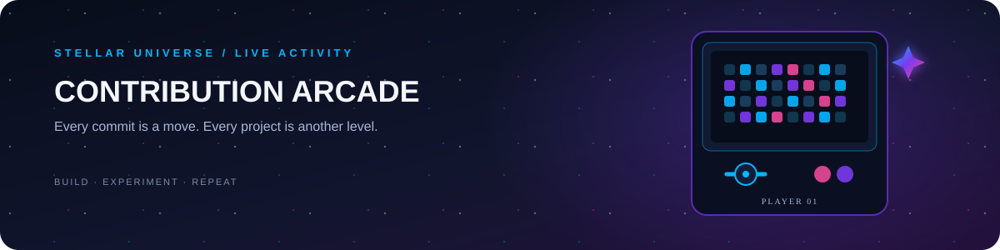  
  </picture>  
  <picture>  
    <source media="(max-width: 600px)" srcset="assets/section-panels/mobile/arcade.svg">  
      
  </picture>  
    
    

  
---

Guestbook

  
  <picture>  
    <source media="(max-width: 600px)" srcset="assets/mobile/guestbook.svg">  
      
  </picture>  
  <picture>  
    <source media="(max-width: 600px)" srcset="assets/section-panels/mobile/guestbook.svg">  
      
  </picture>  

  Have a thought, suggestion, or just want to say hello?

Leave a message in the GitHub Guestbook.

---

Connect

  
  <picture>  
    <source media="(max-width: 600px)" srcset="assets/section-panels/mobile/socials.svg">  
    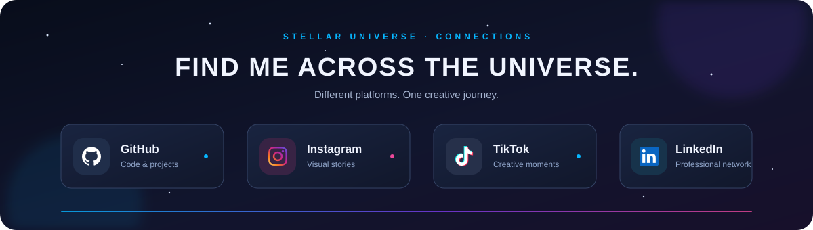  
  </picture>  GitHub ·
Instagram ·
TikTok ·
LinkedIn

  
  
  <picture>  
    <source media="(max-width: 600px)" srcset="assets/mobile/break.svg">  
      
  </picture>  
    Designing ideas · Building experiences · Exploring what’s next

  Berikan full code yg baru dan rapih
